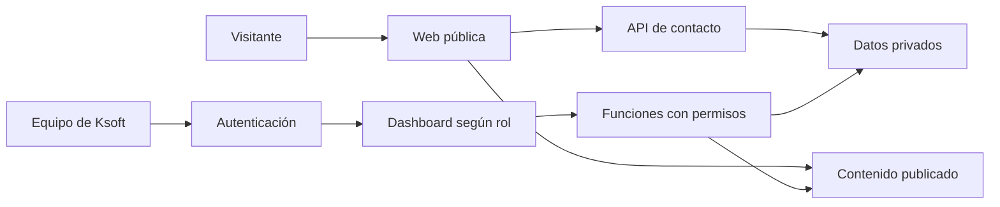

# Ksoft Technology

**Sitio corporativo y plataforma privada de gestión de Ksoft Technology.**

Presenta los servicios de desarrollo a medida, los productos SaaS y las novedades de la empresa. Su dashboard permite administrar contenido, relaciones comerciales, proyectos de clientes, productos propios y el trabajo del equipo.

[Visitar la web](https://ksoftdev.vercel.app) · [Administración](docs/administracion.md) · [Equipo y proyectos propios](docs/equipo-y-tickets.md) · [Licencia](LICENSE)

## Contenido

- [Funcionalidades](#funcionalidades)
- [Roles y permisos](#roles-y-permisos)
- [Arquitectura](#arquitectura)
- [Instalación local](#instalación-local)
- [Configuración de Supabase](#configuración-de-supabase)
- [Publicación de contenido](#publicación-de-contenido)
- [Desarrollo y comprobaciones](#desarrollo-y-comprobaciones)
- [Despliegue](#despliegue)
- [Estructura del repositorio](#estructura-del-repositorio)
- [Alcance y límites](#alcance-y-límites)
- [Documentación](#documentación)
- [Mantenimiento y licencia](#mantenimiento-y-licencia)

## Funcionalidades

### Web pública

- Presentación de la empresa, servicios, forma de trabajo y canales de contacto.
- Catálogo de productos con fichas comerciales, beneficios, preguntas frecuentes y galerías.
- **Ksoft Dental:** gestión para consultorios odontológicos; preparación de piloto y modelo de suscripción por planes.
- **Ksoft Travel:** plataforma para turismo; preparación de piloto y modelo de comisión.
- Publicaciones con listado de novedades y páginas de detalle.
- Formulario de contacto y solicitudes de piloto que conservan el producto elegido.
- Navegación adaptable, metadatos por página y controles de accesibilidad.

Las fichas describen la disponibilidad de cada producto. La web corporativa y su dashboard son una aplicación independiente de los sistemas Dental y Travel.

### Dashboard privado

| Área | Funcionalidades |
| --- | --- |
| Contenido | Publicaciones, productos y casos públicos con edición, vistas previas, borradores y publicación. |
| Gestión comercial | Solicitudes, contactos, clientes y cotizaciones con relaciones entre registros. |
| Operación | Proyectos, tareas, archivos y seguimiento de soporte a clientes. |
| Proyectos propios | Desarrollo de SaaS vinculados al catálogo e iniciativas internas sin cliente ni cotización. |
| Finanzas | Registro de pagos y gastos, reportes y exportación CSV. |
| Equipo | Creación de empleados, roles, suspensión de acceso y asignación de proyectos y tareas. |
| Colaboración | Tickets internos con responsables, prioridades, respuestas, estados y avisos sin leer. |
| Administración | Configuración de empresa, respaldos JSON, papelera, historial y perfil personal. |

El menú público no incluye accesos al dashboard. Su protección depende de la autenticación y los permisos comprobados en el servidor.

## Roles y permisos

| Rol | Acceso |
| --- | --- |
| **Administración** | Contenido, operaciones, finanzas, equipo, asignaciones y todos los tickets internos. |
| **Development** | Consulta sus proyectos, actualiza su avance y modifica estados y notas de las tareas que tiene asignadas. |
| **QA** | Consulta sus proyectos y actualiza estados y notas de sus tareas asignadas; no modifica el avance del proyecto. |
| **Empleado** | Perfil y tickets que crea o tiene asignados. |

Todos los miembros activos pueden crear tickets para administración u otro integrante. En proyectos de clientes e iniciativas internas, las tareas se asignan entre integrantes del proyecto. Al asignar una tarea de un SaaS, sus responsables también se incorporan al equipo del SaaS. Las cuentas administradoras se autorizan mediante un procedimiento de configuración separado; el formulario de empleados no concede ese rol.

Dental y Travel ya están disponibles en **Tareas → Proyecto / SaaS**. También puedes usar **Productos → Crear tarea**, guardar y asignar sus responsables directamente. También se pueden crear SaaS sin ficha comercial y proyectos propios desde **Proyectos → Gestión interna**.

## Arquitectura

| Capa | Tecnología y responsabilidad |
| --- | --- |
| Interfaz | React 19, TypeScript y React Router. |
| Construcción | Vite 7 con React SWC. |
| Presentación | CSS Modules, React Icons y Framer Motion. |
| Identidad y datos | Supabase Auth y PostgreSQL, con RLS y funciones RPC que validan los permisos. |
| Imágenes comerciales | Supabase Storage, bucket público `ksoft-media`. |
| API de servidor | Funciones TypeScript: `/api/contact` y `/api/team`. |
| Hosting | Vercel, con rutas de la SPA y funciones de servidor. |
| Verificación | ESLint, TypeScript y pruebas con Node.js y PostgreSQL embebido mediante PGlite. |



Los visitantes consultan una copia pública del contenido. Los registros comerciales y operativos se leen y modifican mediante funciones autorizadas. Los guardados del espacio de trabajo utilizan una revisión compartida para detectar cambios concurrentes.

## Instalación local

Requisitos: **Node.js 22**, **npm 10**, Git y acceso autorizado a un proyecto de Supabase para utilizar las funciones conectadas.

```bash
git clone https://github.com/kleyderBackend/Ksoft-frontend.git
cd Ksoft-frontend
npm ci
```

En PowerShell, crea la configuración local:

```powershell
Copy-Item .env.example .env.local
```

Completa las variables y ejecuta:

```bash
npm run dev
```

Vite muestra la dirección disponible en la terminal; normalmente es `http://localhost:5173`. El acceso al equipo está en `/dashboard/access`. El servidor de desarrollo también atiende las dos rutas `/api/` mediante el middleware definido en `vite.config.ts`.

Sin variables de Supabase existe un modo local de desarrollo con datos en el navegador. Ese modo no proporciona autenticación, gestión de empleados ni tickets conectados. Una configuración parcial de Supabase bloquea el acceso conectado; no sustituye los datos remotos por una copia local.

### Variables de entorno

| Variable | Entorno | Uso |
| --- | --- | --- |
| `VITE_SUPABASE_URL` | Navegador | URL del proyecto de Supabase. |
| `VITE_SUPABASE_PUBLISHABLE_KEY` | Navegador | Clave pública del proyecto. |
| `SUPABASE_URL` | Servidor | URL utilizada por las funciones de contacto y empleados. |
| `SUPABASE_SERVICE_ROLE_KEY` | Solo servidor | Recepción de solicitudes y creación autorizada de empleados. |
| `CONTACT_SCRIPT_URL` | Solo servidor, opcional | Proveedor de contacto anterior cuando no se configura el servicio de Supabase. |

Se admite también `VITE_SUPABASE_ANON_KEY` para instalaciones con la clave pública anterior. Las variables con prefijo `VITE_` se incorporan al código del navegador: deben contener únicamente configuración pública. La clave de servicio nunca debe utilizar ese prefijo.

`.env.local` y los archivos `*.local` están excluidos de Git y de los despliegues. `.env.example` contiene solo marcadores de configuración. Las contraseñas no forman parte del código ni del README.

## Configuración de Supabase

En una instalación nueva, crea un proyecto independiente para la web corporativa y aplica las migraciones incluidas:

```bash
npx supabase login
npx supabase link --project-ref TU_REFERENCIA_DE_PROYECTO
npx supabase db push
```

Después:

1. Crea la cuenta inicial en Supabase Auth y autorízala en `ksoft_admins`, siguiendo la [guía de configuración](docs/supabase.md).
2. Mantén desactivado el registro público de usuarios.
3. Configura las variables locales y de hosting.
4. Inicializa la configuración de empresa y el catálogo según esa misma guía.
5. Crea las cuentas del equipo desde el dashboard administrador.

Las migraciones versionadas están en `supabase/migrations/`. En un entorno ya configurado, aplica únicamente las pendientes. El esquema de esta web no debe instalarse sobre las bases de datos operativas de Dental o Travel.

## Publicación de contenido

1. Edita una publicación, producto o ficha de proyecto público desde el dashboard administrador.
2. Completa sus textos, imágenes y detalles; revisa la vista previa.
3. Usa **Publicar en la web** para guardar y publicar esa entrada en una transacción.

**Guardar borrador** conserva los cambios privados y mantiene una versión pública anterior, si existe. **Retirar de la web** elimina la versión pública sin borrar el registro privado. Enviar una ficha a la papelera también retira su publicación.

Los cambios de contenido publicados se consultan desde Supabase y no requieren recompilar la web. Los cambios de código o de variables de construcción sí necesitan un despliegue.

La presentación pública de un proyecto es independiente de su gestión interna. Las tareas, notas y documentos internos no se convierten automáticamente en material comercial.

## Desarrollo y comprobaciones

| Comando | Propósito |
| --- | --- |
| `npm run dev` | Iniciar la aplicación y las API locales. |
| `npm run lint` | Revisar las reglas de código. |
| `npm test` | Ejecutar las pruebas de modelos, API y permisos SQL. |
| `npm run build` | Comprobar TypeScript y generar `dist/`. |
| `npm run preview` | Revisar la compilación estática; no inicia las API de servidor. |

Las pruebas SQL utilizan PGlite con esquemas de Auth y Storage simulados; no necesitan credenciales de producción. Cubren permisos por rol, asignaciones, proyectos propios, privacidad de tickets, publicación, relaciones y conflictos de revisión. Las pruebas de API simulan los servicios externos.

Las verificaciones conectadas se documentan en `docs/supabase.md`. Los archivos de `supabase/tests/` ejecutan escenarios en una transacción con reversión; deben utilizarse únicamente sobre un proyecto autorizado. No ejecutes `db reset` sobre un entorno compartido como parte de una comprobación rutinaria.

## Despliegue

El proyecto está preparado para Vercel mediante `vercel.json`:

- Instalación: `npm ci`.
- Construcción: `npm run build`.
- Salida del frontend: `dist/`.
- Funciones de servidor: `api/contact.ts` y `api/team.ts`.
- Reescrituras para las rutas de React Router, conservando `/api/`.

Configura las variables públicas y privadas en el entorno de Vercel correspondiente. Aplica primero las migraciones necesarias de Supabase y despliega después la aplicación. Si usas la CLI con un proyecto vinculado:

```bash
npx vercel deploy --prod
```

`.vercelignore` excluye credenciales, archivos locales, pruebas y documentación del paquete de despliegue. Un hosting exclusivamente estático necesita un servidor adicional para las API de contacto y creación de empleados.

## Estructura del repositorio

```text
api/                         Funciones HTTP de contacto y empleados
server/                      Lógica de servidor para gestión de cuentas
public/img/                  Recursos visuales de la web
src/
  Components/                Componentes de la web y del dashboard
    dashboards/              Modelos, permisos, servicios y gestores del panel
  config/                    Catálogo y contenido inicial de referencia
  content/                   Lectura del contenido público publicado
  lib/                       Cliente de Supabase
  pages/                     Páginas y composición de rutas
    Dashboards/              Una carpeta por módulo del panel
supabase/
  migrations/                Esquema y permisos versionados
  tests/                     Verificaciones SQL transaccionales
tests/                       Pruebas automatizadas
scripts/                     Utilidades de inicialización y comprobación
docs/                        Guías operativas y técnicas
```

Cada módulo mantiene su página en `src/pages/Dashboards/<Módulo>/` y su gestor y CSS Module en `src/Components/dashboards/components/<Módulo>/`. Los componentes compartidos reutilizan formularios y reglas sin duplicar los módulos.

## Alcance y límites

- Las imágenes comerciales admiten PNG, JPG y WebP de hasta 500 KB y se alojan en un bucket público.
- Los documentos del módulo Archivos se conservan en registros privados y en los respaldos; el límite actual es 500 KB por archivo y 6 MB por guardado completo del espacio de trabajo.
- Los registros de pagos y gastos son administrativos; no ejecutan cobros ni transferencias.
- Los tickets son internos. Su indicador se actualiza al recuperar el foco, al consultar conversaciones y periódicamente; no se presenta como mensajería instantánea.
- La integración de contacto con Supabase registra la solicitud; no envía confirmaciones automáticas por correo. La creación de empleados muestra una contraseña inicial una sola vez y tampoco envía correos.
- Los respaldos JSON del panel no incluyen usuarios de Auth, asignaciones de cuentas, tablas de tickets, auditoría de servidor ni los archivos del bucket de imágenes. Esos elementos requieren una estrategia de respaldo adicional en Supabase.

## Documentación

| Guía | Contenido |
| --- | --- |
| [Administración](docs/administracion.md) | Publicar contenido y operar el panel. |
| [Equipo, tickets y proyectos propios](docs/equipo-y-tickets.md) | Roles, empleados, colaboración y desarrollo de SaaS. |
| [Supabase](docs/supabase.md) | Instalación, acceso inicial, datos, permisos y verificaciones. |
| [Dashboard](docs/dashboard.md) | Organización de los módulos y funcionamiento conectado y local. |
| [Catálogo público](docs/portfolio.md) | Criterios comerciales, capturas y solicitudes de piloto. |

## Mantenimiento y licencia

**Responsable:** Kleyder Moreno Davila · Ksoft Technology.

Antes de integrar cambios, ejecuta las comprobaciones del proyecto y conserva la estructura de páginas y componentes. Las modificaciones del esquema deben añadirse como nuevas migraciones; no reescribas migraciones aplicadas. Los cambios en permisos deben acompañarse de pruebas que verifiquen los límites de cada rol.

Este proyecto es **software propietario, con todos los derechos reservados**. Su disponibilidad en un repositorio no concede una licencia abierta de uso, modificación o distribución. Consulta [LICENSE](LICENSE) para el aviso de derechos. Las dependencias y los materiales de terceros conservan sus propias licencias.
